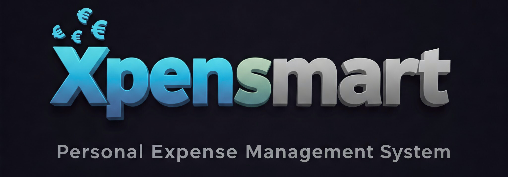

<p align="center"></p>
<h1 align="center">Xpensmart</h1>
<p align="center"><strong>Make everyday spending easier to understand.</strong><br>A full-stack expense manager built with Angular, ASP.NET Core and SQL Server.</p>

<p align="center">
  
  
  
  
  
</p>

## Features

- **Expense tracking** with categories, notes, bulk entry and an editable expenses table
- **Budgets** per category with remaining-amount tracking
- **Recurring expenses** and upcoming-payment reminders
- **Shared accounts and groups** with split expenses
- **Dashboards and reports** with category charts, monthly trends and spending projections
- **Secure sign-up and login** with email OTP verification
- **Receipt uploads** through a lightweight upload service

## Architecture

| Component | Stack |
|---|---|
| `FrontEnd/Expensmart-Main` | Angular, TypeScript, Angular Material, charts |
| `WebAPI/Xpensmart` | ASP.NET Core Web API |
| `WebAPI/ApplicationLayer`, `BusinessLayer`, `DataAccessLayer` | Clean layered C# with Entity Framework Core and the repository pattern |
| `WebAPI/CoreModels` | Shared entities and DTOs |
| `WebAPI/Testing` | NUnit + Moq tests for controllers and services |
| `otp-server` | Express + Nodemailer email OTP service |
| `my-server` | Express + Multer receipt-upload service |
| `database/schema.sql` | SQL Server schema |

## Run locally

Prerequisites: Node.js, npm, .NET SDK, and SQL Server / LocalDB.

1. Create an empty database named `Xpensmart` and run `database/schema.sql` against it.
2. Point `WebAPI/Xpensmart/appsettings.json` at your database, or set `ConnectionStrings__DefaultConnection`.
3. Set `XPENSMART_ENCRYPTION_KEY` to a locally generated development key.
4. Start the API:

```powershell
dotnet run --project WebAPI\Xpensmart\Xpensmart.csproj --launch-profile https
```

5. Start the frontend in a second terminal:

```powershell
Set-Location FrontEnd\Expensmart-Main
npm ci
npm start -- --port 8989
```

6. Optional services: copy `otp-server/.env.example` to `otp-server/.env` with your own sender credentials, then run `npm ci` and `node server.js` in `otp-server`. Do the same in `my-server` (create an `uploads` folder first) for receipt uploads.

The frontend calls the API at `https://localhost:7154`, and CORS expects the frontend on port `8989`.

## Note

Xpensmart is a personal learning project. Harden authentication, OTP handling and file uploads before using it with real financial data.